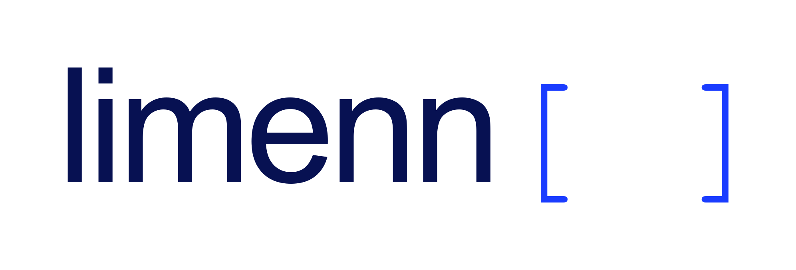
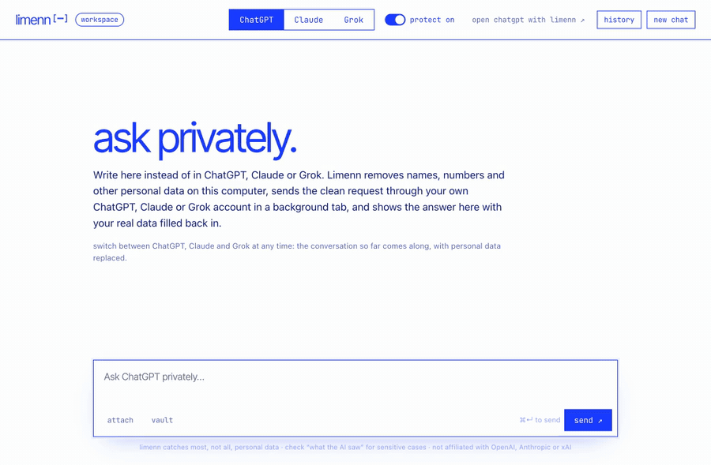
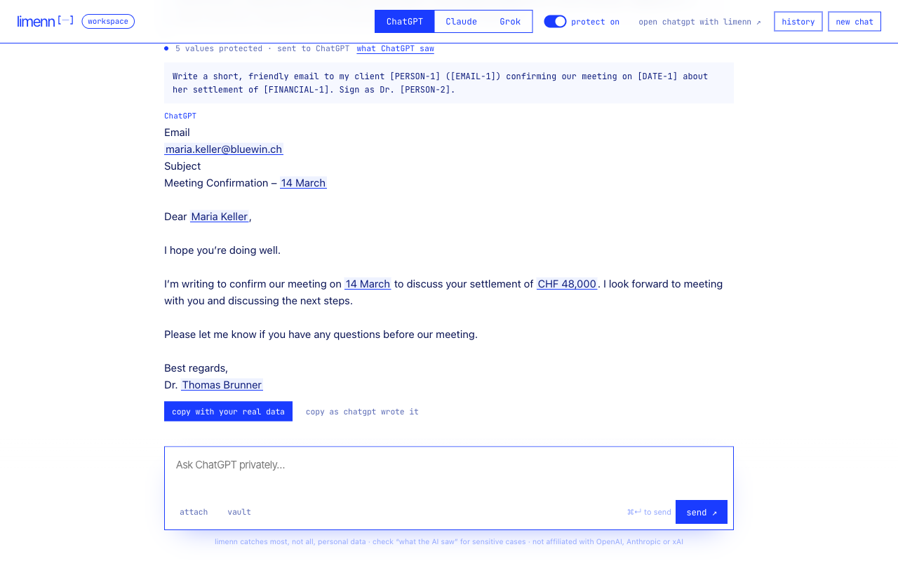
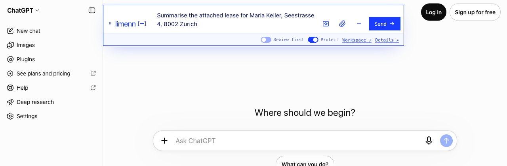
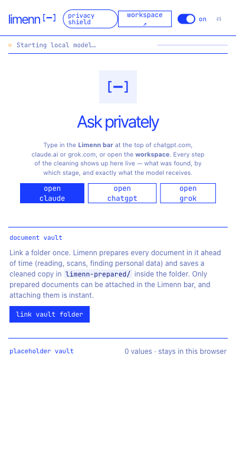

<p align="center">
  <picture>
    <source media="(prefers-color-scheme: dark)" srcset="docs/assets/logo-dark.png">
    
  </picture>
</p>

<p align="center"><b>Use ChatGPT, Claude and Grok without giving away personal data.</b><br>
limenn replaces names, numbers and other personal details with placeholders <i>before</i> anything leaves your computer,<br>and puts the real values back into the answer.</p>

<p align="center">
  
</p>

```
You write:     Draft an email to Maria Keller (maria.keller@bluewin.ch) about her settlement of CHF 48,000.
ChatGPT sees:  Draft an email to [PERSON-1] ([EMAIL-1]) about her settlement of [FINANCIAL-1].
You read:      Dear Maria Keller, … your settlement of CHF 48,000 …        ← filled in on your computer
```

## Install in 1 minute

1. **Download** `limenn-<version>.zip` from [Releases](../../releases/latest) and unzip it.
2. Open **`chrome://extensions`**, switch on **Developer mode** (top right) and click **Load unpacked**. Choose the unzipped folder.
3. A welcome page opens and walks you through the rest. Pin limenn with the puzzle icon 🧩 so it's always one click away.

Works in Chrome, Edge, Brave and Arc (Chromium 120+). A Chrome Web Store listing is on its way.

<details>
<summary><b>Build from source instead</b></summary>

```bash
git clone https://github.com/jatlantic/Limenn.git && cd Limenn
npm install
npm run build        # downloads the pinned, hash-checked models once, then builds into dist/
```
Then load the `dist/` folder as above. Run `npm test` for the test suite. The optional second detector (`gliner-web-q8.onnx`) is part of the release package. To include it in your own build, set `LIMENN_WEB_MODEL_URL`; without it, limenn uses its rules and the name model.
</details>

## Use it

| | |
|---|---|
| **workspace**: limenn's own tab, and the most private way to use it. Write, pick ChatGPT, Claude or Grok, and read the answer with your data restored. Switch assistants mid-conversation, copy answers with one click, and see a history of the session (deleted when the browser closes). |  |
| **limenn bar**: appears at the top of chatgpt.com, claude.ai and grok.com. Type there instead of the site's own box. Drag it anywhere on the page. |  |
| **side panel**: click the toolbar icon to see what was found and exactly what the AI received, and to link a **document folder**. PDFs, Word, Excel, PowerPoint, e-mails and scans are prepared ahead of time, so attaching them is instant. |  |

Switch protection off and on at any time with the **protect** switch in the bar, the side panel or the workspace.

## What stays on your computer

- **Everything that is personal.** Your text, your files and the list of which placeholder stands for what. Detection, document reading and text recognition for scans all run locally, and every model ships inside the extension.
- **No servers, accounts, analytics or telemetry.** limenn makes no network requests of its own. The AI receives only the cleaned text, through your own account.
- **The details:** [PRIVACY.md](PRIVACY.md) and [SECURITY.md](SECURITY.md). The short version: detection is very good but not perfect, so check *what ChatGPT saw* before sending anything highly sensitive.

## License

Free for personal use, research, education, non-profits and public institutions, under the [PolyForm Noncommercial License 1.0.0](LICENSE). **Commercial use requires a license.** Contact us via [limenn.io](https://limenn.io). Bundled models, fonts and libraries keep their own open licenses ([THIRD_PARTY_NOTICES.md](THIRD_PARTY_NOTICES.md)).
